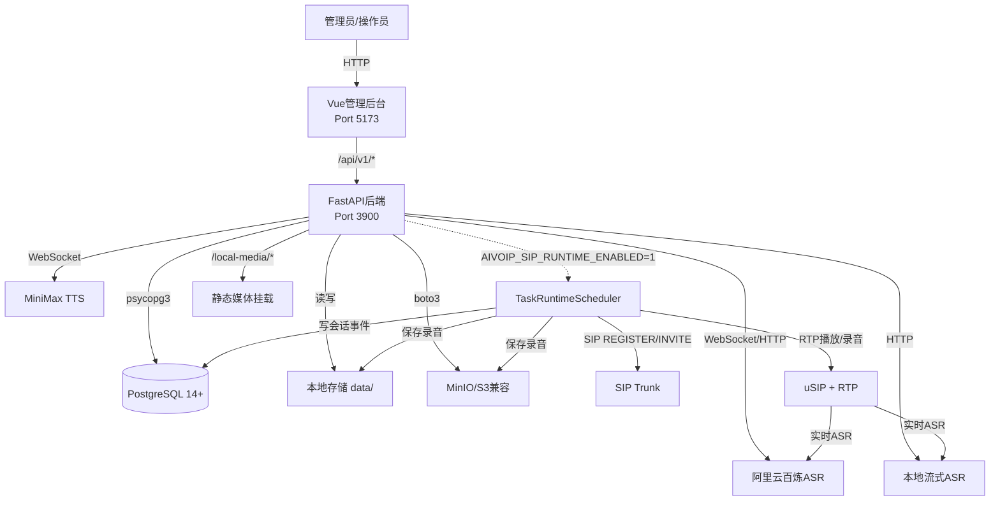
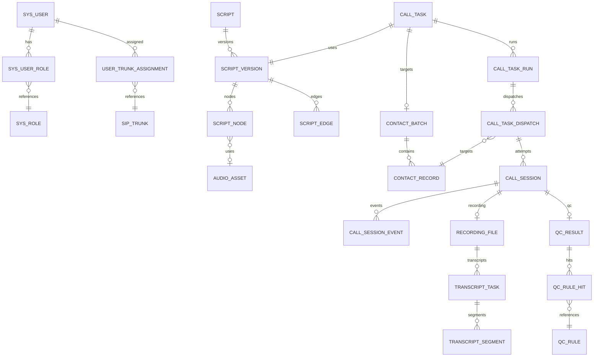
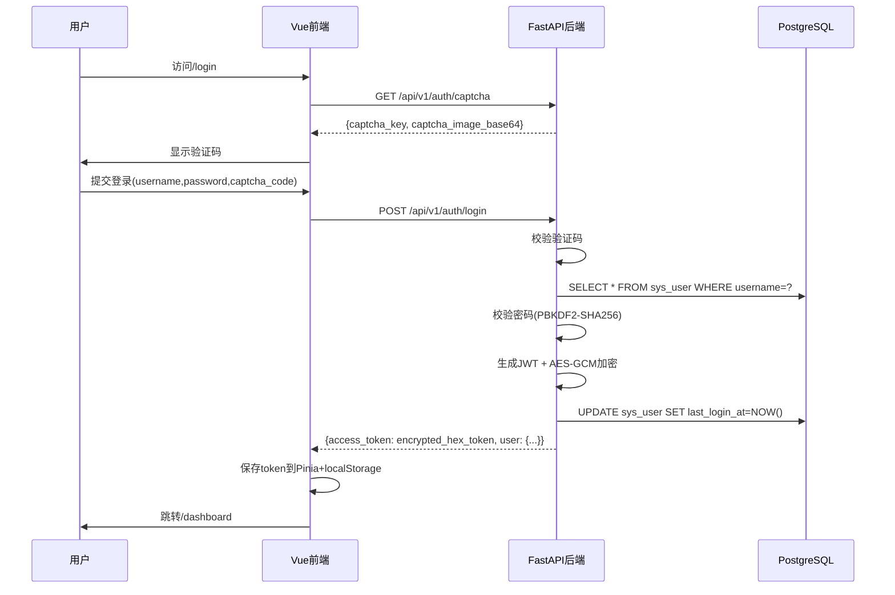
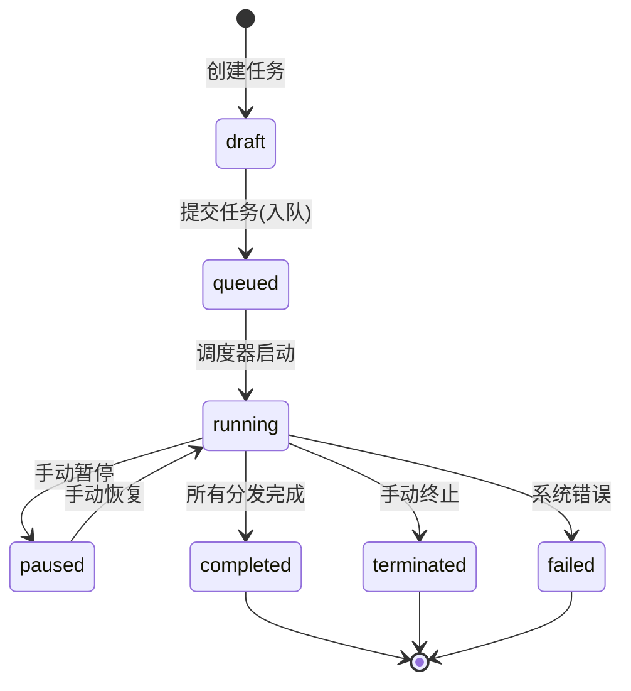
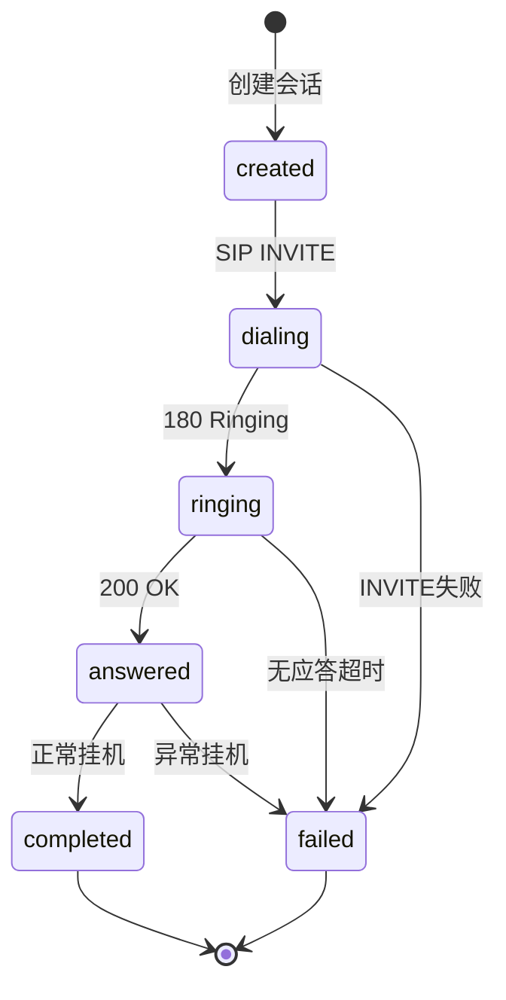
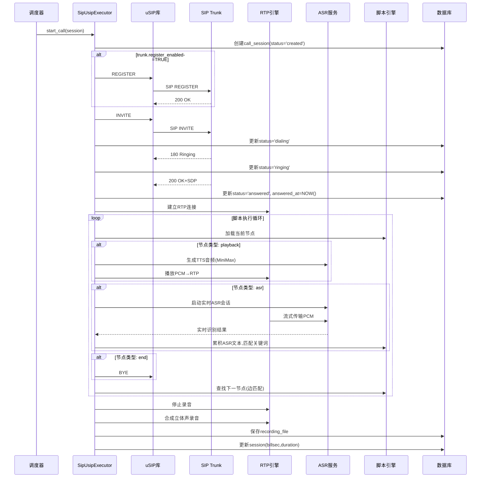

# AI VoIP 智能外呼平台 - 详细设计文档

> **Document Version**: 1.0  
> **Date**: 2026年9月20日  
> **Source Repository**: https://github.com/loveylwforever/ai_voip  
> **License**: GPL-3.0  
> **技术栈快照**: Python 3.10 + FastAPI + PostgreSQL 14+ + Vue 3.5 + uSIP

---

## 📋 目录

1. [文档元信息](#0-文档元信息)
2. [产品概览](#1-产品概览)
3. [系统架构](#2-系统架构)
4. [领域模型](#3-领域模型)
5. [端到端业务流程](#4-端到端业务流程)
6. [脚本引擎详细设计](#5-脚本引擎详细设计)
7. [呼叫运行时/SIP执行器](#6-呼叫运行时sip执行器)
8. [API目录](#7-api目录)
9. [前端功能映射](#8-前端功能映射)
10. [权限/多租户/角色](#9-权限多租户角色)
11. [非功能性与运维](#10-非功能性与运维)
12. [缺口与风险](#11-缺口与风险)
13. [Java模块映射建议](#12-java模块映射建议)

---

## 0. 文档元信息

### 0.1 文档目的

本文档基于 `ai_voip` 仓库的**已实现代码与数据库结构**编写,为 Jamie 使用 **Java 技术栈重建智能外呼系统**提供详尽的产品与技术设计蓝图。

**关系说明**: 本文档深度扩展了先前功能清单文档 (`uploads/ai_voip-功能清单.md`),从产品功能列表深入到完整的领域模型、业务流程、脚本引擎算法、通话运行时逻辑、API设计视图和前后端协作模式。

**设计原则**: 本文档**仅描述当前仓库已实现的功能与架构**,不创造未实现的理想功能。所有描述均引用源代码路径、SQL DDL或配置文件作为证据。对于代码逻辑不清晰的地方,使用 **【待确认】** 标记。

### 0.2 源仓库快照

| 项 | 值 |
|---|---|
| **仓库地址** | https://github.com/loveylwforever/ai_voip |
| **开源协议** | GPL-3.0 |
| **后端** | Python 3.10, FastAPI, uvicorn, psycopg3, PyJWT, httpx, websockets, boto3, **usip** |
| **前端** | Vue 3.5, Vite 6, Element Plus, Pinia, Vue Router, Axios, xlsx, Sass |
| **数据库** | PostgreSQL 14+ (原生 SQL DDL, 共90个SQL文件, 约1089行) |
| **SIP 集成** | uSIP (Python SIP 客户端, ~3244行 `sip_usip_service.py`) |
| **TTS** | MiniMax WebSocket |
| **ASR** | 阿里云百炼实时WebSocket + 文件API, 本地流式ASR HTTP |
| **存储** | 本地 + MinIO/S3 兼容 (boto3) |
| **后端代码量** | 18个服务模块, 共~13177行; 13个路由模块, 约93个API端点 |
| **前端代码量** | 13个页面组件, 其中ScriptView.vue ~3147行 |

---

## 1. 产品概览

### 1.1 产品定义

AI VoIP 智能外呼平台是一个**基于脚本流程编排的智能外呼系统**,核心功能:

1. **SIP线路管理**: 支持 `sip_account` (SIP账号) 与 `gateway` (网关) 两种接入
2. **话术可视化编排**: 节点-边图谱配置对话流程 (TTS播报 + ASR识别 + 关键词分支)
3. **名单批量导入**: Excel/CSV/TXT格式联系人导入
4. **任务调度与并发控制**: 按任务并发度、CPS、线路池自动分配外呼
5. **录音与转写**: 录音落盘(本地/S3), 在线ASR转写, 客服/客户对话时间线
6. **基础质检**: 质检规则配置和结果列表(轻量级实现)

**核心定位**: **关键词匹配驱动**的脚本机器人平台,**不是LLM对话智能体**,**不是呼叫中心坐席系统**。

### 1.2 参与者

| 角色 | 种子角色代码 | 权限特征 | UI区分 |
|------|------------|---------|--------|
| **超级管理员** | `super_admin` | 全部权限 | `meta.adminOnly` |
| **企业管理员** | `enterprise_admin` | 管理员权限 | `meta.adminOnly` |
| **运维管理员** | `ops_admin` | 管理员权限 | `meta.adminOnly` |
| **坐席用户** | `agent_user` | 仅看自己数据 + 已分配线路 | 普通用户 |
| **质检管理员** | `qc_admin` | 【待确认】UI未细分 | 普通用户 |
| **查看者** | `viewer` | 【待确认】UI未细分 | 普通用户 |
| **系统调度器** | TaskRuntimeScheduler | 后台进程 | 非人类 |

**权限模型**: 粗粒度二分 - 管理员 vs 普通用户,无细粒度RBAC (证据: `api/permissions.py`, `docs/API.md`明确说明)。

### 1.3 范围外功能 (证据)

| 功能 | 证据来源 |
|------|---------|
| **LLM对话智能体** | 脚本引擎基于关键词匹配(`runtime_service.py`), 无LLM API调用 |
| **Asterisk/FreeSWITCH/LiveKit集成** | 仅uSIP拨号器; README提及作者另有独立FreeSWITCH模块但不在此仓库 |
| **真正的多租户/组织** | 无`organization`表; 单数据库架构 |
| **呼叫中心坐席软电话** | 无WebRTC/LiveKit; `agent_user`角色存在但无坐席在线状态、ACD队列 |
| **运营商对接线路** | README: "目前线路只有SIP,暂时还没做对接线路" |
| **ESL** | README: "也没有做ESL" |
| **Webhook/CRM回调** | 代码中无webhook路由/服务 |
| **Docker/K8s部署** | 无Dockerfile, docker-compose.yml, K8s YAML |
| **Prometheus/OpenTelemetry** | 仅文件日志(`log/info.log`, `log/error.log`) |
| **细粒度RBAC** | `docs/API.md`: "目前尚未实现基于角色的细粒度权限控制" |

---

## 2. 系统架构

### 2.1 组件架构图



### 2.2 进程/运行时模型

| 进程 | 启动方式 | 职责 |
|------|---------|------|
| **FastAPI主进程** | `uv run ai-voip-api`<br/>(`server.py`) | HTTP API服务; CORS; 错误处理; 静态媒体挂载; 可选启动调度器 |
| **TaskRuntimeScheduler** | FastAPI启动时条件创建<br/>(if `AIVOIP_SIP_RUNTIME_ENABLED=1`) | 从`call_task_dispatch`拉取待呼叫; 按并发度/CPS调度; 调用`SipUsipExecutor`发起SIP呼叫; 循环轮询 |
| **SipUsipExecutor** | 由Scheduler调用 | 单次呼叫生命周期: REGISTER→INVITE→RTP播放/录音→ASR识别→脚本引擎→挂机→保存录音 |

**调度器伪代码** (`services/task_runtime_scheduler.py`):

```python
while True:
    running_tasks = fetch_running_tasks()
    for task in running_tasks:
        available_concurrency = calculate_available(task)
        if available_concurrency > 0:
            dispatches = fetch_pending_dispatches(task, limit=available_concurrency)
            for dispatch in dispatches:
                trunk = allocate_trunk_from_pool(task.trunk_ids)
                session = create_session(dispatch, trunk)
                asyncio.create_task(SipUsipExecutor.start_call(session))
    await asyncio.sleep(interval)
```

### 2.3 配置与环境变量

#### 后端环境变量 (`.env.example`)

| 变量 | 必填 | 说明 |
|------|------|------|
| `AIVOIP_PG_HOST` | ✅ | PostgreSQL地址 |
| `AIVOIP_PG_PORT` | ✅ | PostgreSQL端口(默认5432) |
| `AIVOIP_PG_USER` | ✅ | 数据库用户 |
| `AIVOIP_PG_PASSWORD` | ✅ | 数据库密码 |
| `AIVOIP_PG_DATABASE` | ✅ | 数据库名(默认ai_voip) |
| `AIVOIP_JWT_SECRET` | ✅ | JWT签名密钥(≥32字符) |
| `AIVOIP_JWT_EXPIRE_MINUTES` | ✅ | JWT过期时间(分钟,默认1440) |
| `AIVOIP_TOKEN_ENCRYPTION_KEY` | ✅ | Token AES-GCM加密密钥(≥32字符) |

**⚠️ SIP运行时变量缺失**: `config.py`中定义了`SipRuntimeConfig`类,使用环境变量如`AIVOIP_SIP_RUNTIME_ENABLED`等,但**这些变量未在`.env.example`中列出**。

#### 数据库配置 (`sys_config`表, `090_seed_data.sql`)

```sql
INSERT INTO sys_config (config_key, config_value, description)
VALUES
    ('storage.default_backend', '"local"'::JSONB, '默认存储后端'),
    ('scheduler.max_parallel_tasks', '100'::JSONB, '最大并行任务数'),
    ('retention.recording_days', '90'::JSONB, '录音保留天数'),
    ('retention.log_days', '30'::JSONB, '日志保留天数'),
    ('system.models_root', '"./models"'::JSONB, '本地模型存储根目录');
```

**⚠️ `system.models_root`**: `models/`目录为空占位(.gitkeep),用途不明。

### 2.4 部署拓扑

**当前支持**:
- **本地开发**: 手动启动PostgreSQL + `uv run ai-voip-api` + `npm run dev`
- **生产部署**: 无现成配置(无Docker/K8s),需自行编写

---

## 3. 领域模型 (Domain Model)

### 3.1 核心实体ER图



### 3.2 核心实体详解

#### 3.2.1 用户与权限

**`sys_user`** (`010_base_tables.sql`)
- 字段: id, username(unique), password_hash(PBKDF2-SHA256), display_name, status(`active`|`disabled`|`locked`)
- 密码加密: `services/security.py`, 100000轮PBKDF2-SHA256

**`sys_role`** (`010_base_tables.sql`)
- 种子角色(`090_seed_data.sql`): `super_admin`, `enterprise_admin`, `ops_admin`, `agent_user`, `qc_admin`, `viewer`

**`user_trunk_assignment`** (`085_access_control_tables.sql`)
- 管理员为普通用户分配可用SIP线路

#### 3.2.2 SIP线路

**`sip_trunk`** (`020_trunk_tables.sql` + `086_trunk_type_fields.sql`)

| 字段 | 类型 | 说明 |
|------|------|------|
| trunk_code | VARCHAR(64) UNIQUE | 线路代码 |
| server_host | VARCHAR(255) | SIP服务器地址 |
| server_port | INTEGER | SIP端口(默认5060) |
| transport | VARCHAR(16) | 传输协议: `udp`\|`tcp`\|`tls` |
| username | VARCHAR(128) | SIP用户名 |
| password_cipher | TEXT | SIP密码(明文存储⚠️) |
| max_concurrency | INTEGER | 最大并发 |
| cps_limit | INTEGER | CPS限制 |
| trunk_status | VARCHAR(32) | `draft`\|`enabled`\|`disabled`\|`error` |

**线路类型**:
- `sip_account`: 需REGISTER注册
- `gateway`: 无需注册,直接INVITE

#### 3.2.3 话术脚本

**`script`** → **`script_version`** → **`script_node`** + **`script_edge`** (`030_script_tables.sql`)

**节点类型** (CHECK约束):
```sql
CHECK (node_type IN ('start', 'playback', 'asr', 'branch', 'intent', 'confirm', 'transfer', 'fallback', 'end'))
```

**⚠️ 前端限制**: `ScriptView.vue`仅支持创建`start`, `playback`, `asr`, `end`四种节点。

**边条件类型** (CHECK约束):
```sql
CHECK (condition_type IN ('always', 'keyword', 'intent', 'timeout', 'silence', 'nomatch', 'expression'))
```

**`script_node.node_config`** 示例:
```json
{
  "tts_text": "您好,这里是智能客服",
  "tts_provider_id": 1,
  "asr_timeout_seconds": 5,
  "asr_max_silence_seconds": 2
}
```

**`script_edge.condition_config`** 示例:
```json
{
  "keywords": ["是的", "可以", "没问题"],
  "match_mode": "any"
}
```

#### 3.2.4 联系人

**`contact_batch`** → **`contact_record`** (`040_contact_tables.sql`)

- 批次来源: `csv`|`xlsx`|`manual`|`api`
- 导入实现: `services/contact_service.py` (~502行), 支持Excel(openpyxl), CSV, TXT

#### 3.2.5 任务与调度

**`call_task`** (`050_task_tables.sql`)

| 字段 | 说明 |
|------|------|
| task_status | `draft`\|`queued`\|`running`\|`paused`\|`completed`\|`terminated`\|`failed` |
| max_concurrency | 最大并发数 |
| cps_limit | 每秒呼叫数限制 |
| retry_limit | 重试次数 |
| call_time_range | 呼叫时间窗口(JSONB) |
| current_run_id | 当前执行批次ID |

**`call_task_run`** (`087_task_run_tables.sql`)
- 用途: 支持同一任务多次运行,每次运行的分发表与会话独立归档
- 唯一约束: `UNIQUE (task_id, run_no)`

**`call_task_dispatch`** (`050_task_tables.sql` + `087_task_run_tables.sql`)
- 分发状态: `pending`|`dialing`|`success`|`failed`|`retry_wait`|`skipped`|`blocked`
- 唯一约束: `UNIQUE INDEX (task_run_id, contact_record_id)`

**`call_session`** (`050_task_tables.sql`)
- 会话状态: `created`|`dialing`|`ringing`|`answered`|`completed`|`failed`|`cancelled`
- 应答状态: `unanswered`|`answered`|`voicemail`|`busy`|`rejected`|`timeout`
- 意向等级: `A`|`B`|`C`|`D`|`E`|`F` (可为NULL)

**`call_session_event`** (050_task_tables.sql`)
- 事件类型: `dial`|`ringing`|`answer`|`hangup`|`node_enter`|`node_exit`|`asr_result`|`transfer`|`system`

#### 3.2.6 媒体与转写

**`recording_file`** (`060_media_tables.sql`)
- 录音类型: `mixed`|`caller`|`callee`
- 存储后端: `local`|`s3_compatible`

**`transcript_task`** → **`transcript_segment`** (`060_media_tables.sql`)
- 转写任务状态: `pending`|`processing`|`completed`|`failed`
- 分段字段: speaker_label(客服/客户), begin_ms, end_ms, text_content

**`audio_asset`** (`030_script_tables.sql`)
- 资源类型: `pre_recorded`|`tts_cache`|`upload`

#### 3.2.7 质检

**`qc_rule`** (`070_qc_tables.sql`)
- 规则类型: `keyword`|`intent`|`compliance`|`risk`|`flow`

**`qc_result`** (`070_qc_tables.sql`)
- 唯一约束: `UNIQUE (session_id)` - 一个会话一条质检结果

---

## 4. 端到端业务流程 (详细)

### 4.1 管理员认证与登录

#### 流程图



**实现文件**:
- 验证码: `services/captcha_service.py`
- 认证: `services/auth_service.py`
- 密码加密: `services/security.py`
- 鉴权依赖: `api/dependencies.py`

**Token加密**: JWT明文 → AES-GCM加密 → 十六进制字符串返回前端

**后续请求鉴权**: 前端每次请求携带`Authorization: Bearer <encrypted_token>` → 后端解密 → 验证JWT → 查询用户

### 4.2 创建与配置外呼任务

#### 前置准备
1. SIP线路(状态`enabled`)
2. 已发布的脚本版本
3. 包含联系人的批次

#### 任务状态机



**API**:
- 创建: `POST /api/v1/tasks`
- 更新状态: `PATCH /api/v1/tasks/{task_id}/status`

**任务配置字段**:
- `task_name`, `script_version_id`, `trunk_ids`(线路池), `batch_id`
- `max_concurrency`(最大并发), `cps_limit`(CPS限制), `retry_limit`
- `call_time_range`: `{"start": "09:00", "end": "18:00"}`

**实现**: `services/task_service.py` (~913行)

### 4.3 导入联系人 (Excel)

**API**: `POST /api/v1/contacts/records/import`

**支持格式**: xlsx(openpyxl), csv(csv.DictReader), txt(逐行)

**必填字段**: `mobile` (手机号)

**可选字段**: `customer_name`, 其他列作为`ext_fields`(JSONB)存储

**错误处理**: 格式错误/号码重复 → 跳过该行,记录失败

**实现**: `services/contact_service.py` (~502行)

### 4.4 调度器拾取工作

**启用条件**: `AIVOIP_SIP_RUNTIME_ENABLED=1`

**调度循环** (`services/task_runtime_scheduler.py` ~400行):

```python
while True:
    running_tasks = fetch_running_tasks()
    for task in running_tasks:
        # 计算可用并发 = min(任务并发, 线路并发, 全局并发, CPS限制)
        available = calculate_available_concurrency(task)
        if available > 0:
            dispatches = fetch_pending_dispatches(task, limit=available)
            for dispatch in dispatches:
                trunk = allocate_trunk_from_pool(task.trunk_ids)
                session = create_session(dispatch, trunk)
                asyncio.create_task(SipUsipExecutor.start_call(session))
    await asyncio.sleep(interval)
```

**并发控制**:
1. 任务级: `task.max_concurrency`
2. 线路级: `trunk.max_concurrency`
3. 全局级: `sys_config.scheduler.max_parallel_tasks`
4. CPS限制: `task.cps_limit`

### 4.5 单次呼叫生命周期

#### 呼叫状态机



#### 完整流程 (`services/sip_usip_service.py` ~3244行)



**关键逻辑**:
1. **SIP信令**: REGISTER→INVITE→ACK→BYE
2. **RTP媒体**: 播放TTS/预录音,录音被叫音频,合成立体声
3. **实时ASR**: WebSocket/HTTP流式传输音频,接收识别结果
4. **脚本引擎**: 节点执行→边条件匹配→跳转下一节点
5. **会话事件**: 记录所有关键事件到`call_session_event`

**挂机原因**: `NORMAL_CLEARING`|`USER_BUSY`|`NO_ANSWER`|`CALL_REJECTED`|`INVALID_NUMBER`|`NETWORK_FAILURE`|`MEDIA_TIMEOUT`

---

## 5. 脚本引擎详细设计

### 5.1 数据结构

**脚本图谱**:
- **节点(Node)**: 对话步骤 (`script_node`表)
- **边(Edge)**: 条件判断 (`script_edge`表)
- **起始节点**: `script_version.start_node_code`

**图谱加载** (`services/runtime_service.py` - `load_script_graph()`):

```python
def load_script_graph(connection, script_version_id):
    version = get_script_version_by_id(connection, script_version_id)
    nodes = list_script_nodes(connection, script_version_id)
    edges = list_script_edges(connection, script_version_id)
    return {
        "version": version,
        "nodes_by_code": {node["node_code"]: node for node in nodes},
        "edges": edges
    }
```

### 5.2 匹配算法

**边条件类型与匹配逻辑** (`runtime_service.py` - `_match_edge()`):

| condition_type | 触发条件 | 匹配逻辑 |
|---------------|---------|---------|
| `always` | 无条件 | 总是返回True |
| `keyword` | ASR文本包含关键词 | `match_mode='any'`: 任意关键词匹配<br/>`match_mode='all'`: 全部关键词匹配 |
| `timeout` | ASR超时 | `payload.get("timeout", False)` |
| `silence` | ASR静默 | `payload.get("silence", False)` |
| `nomatch` | 无匹配 | 所有关键词边都不匹配时触发 |
| `intent` | 意图匹配 | 【待确认】实现不完整 |
| `expression` | 表达式判断 | 【待确认】实现不完整 |

**匹配伪代码**:

```python
def _match_edge(edge, payload):
    if edge["condition_type"] == "always":
        return True
    
    if edge["condition_type"] == "keyword":
        keywords = edge["condition_config"].get("keywords", [])
        asr_text = payload.get("asr_text", "")
        match_mode = edge["condition_config"].get("match_mode", "any")
        
        if match_mode == "any":
            return any(kw in asr_text for kw in keywords)
        elif match_mode == "all":
            return all(kw in asr_text for kw in keywords)
    
    if edge["condition_type"] == "timeout":
        return payload.get("timeout", False)
    
    if edge["condition_type"] == "silence":
        return payload.get("silence", False)
    
    if edge["condition_type"] == "nomatch":
        return payload.get("nomatch", False)
    
    return False
```

**边优先级**: 按`sort_order`升序排序,优先匹配`sort_order`小的边。

**回退逻辑**: 所有关键词边不匹配 → 触发`nomatch`边 → 若无`nomatch`边,查找`fallback`节点或直接挂机。

### 5.3 节点动作类型

| 节点类型 | 行为 | node_config参数 | 前端支持 |
|---------|------|----------------|---------|
| `start` | 脚本起点 | - | ✅ |
| `playback` | 播放TTS/预录音 | `tts_text`, `tts_provider_id`, `audio_asset_id` | ✅ |
| `asr` | 启动语音识别 | `asr_timeout_seconds`, `asr_max_silence_seconds`, `asr_provider_id` | ✅ |
| `end` | 结束通话 | `hangup_cause` | ✅ |
| `branch` | 分支节点 | `expression` | ❌ |
| `intent` | 意图识别 | `intent_code` | ❌ |
| `confirm` | 确认节点 | - | ❌ |
| `transfer` | 转接节点 | `transfer_number` | ❌ |
| `fallback` | 后备节点 | - | ❌ |

**证据**: 前端`web-admin-vue3/src/views/scripts/ScriptView.vue`仅暴露`start`, `playback`, `asr`, `end`四种节点创建入口。

### 5.4 时序控制

**ASR超时** (`node_config.asr_timeout_seconds`):
- 从ASR启动开始计时
- 超时触发`timeout`边条件

**ASR静默** (`node_config.asr_max_silence_seconds`):
- 检测被叫音频静默时长
- 超时触发`silence`边条件

**最大轮次**: 【待确认】当前无明确最大轮次限制,由脚本图谱是否有环决定。

### 5.5 状态管理

**每个会话的状态**:
- `call_session.current_node_code`: 当前节点代码
- `call_session_variable`: 会话变量(key-value对)
  - `source_type`: `system`|`contact`|`asr`|`manual`
  - 用途: 存储意向等级、客户填充的槽位等

**实现文件**:
- 脚本引擎核心: `services/runtime_service.py` (~658行)
- 单步执行: `execute_script_step()`
- 模拟执行: `simulate_script()`

---

## 6. 呼叫运行时/SIP执行器

### 6.1 AIVOIP_SIP_RUNTIME_ENABLED 控制

**作用**: 控制是否启动`TaskRuntimeScheduler`后台进程

**配置位置**: `config.py` - `SipRuntimeConfig`类

**⚠️注意**: 该变量未在`.env.example`中列出

### 6.2 调度器循环

**实现**: `services/task_runtime_scheduler.py` (~400行)

**循环间隔**: 可配置(默认数秒)

**选择任务逻辑**:
```sql
SELECT * FROM call_task
WHERE task_status = 'running' AND deleted_at IS NULL
```

**选择分发记录** (拉取待呼叫):
```sql
SELECT * FROM call_task_dispatch
WHERE task_run_id = ? AND dispatch_status = 'pending' AND deleted_at IS NULL
ORDER BY id ASC
LIMIT ?
```

**并发控制**:
- 任务级: 当前活跃会话数 < `max_concurrency`
- 线路级: 遍历`trunk_ids`,选择第一个有可用并发的线路
- 全局级: 系统总活跃会话数 < `sys_config.scheduler.max_parallel_tasks`
- CPS限制: 每次迭代最多发起`cps_limit`个呼叫

### 6.3 SipUsipExecutor 职责

**实现**: `services/sip_usip_service.py` (~3244行)

**核心功能**:

1. **SIP信令**:
   - REGISTER (条件: `trunk.register_enabled=TRUE`)
   - INVITE (发起呼叫)
   - ACK (应答确认)
   - BYE (挂机)
   - CANCEL (取消呼叫)

2. **RTP媒体流**:
   - 播放TTS音频 (PCM → RTP)
   - 播放预录音频 (读取文件 → PCM → RTP)
   - 录音被叫音频 (RTP → PCM)
   - 合成立体声录音 (左声道=主叫, 右声道=被叫)

3. **实时ASR集成**:
   - 启动ASR会话 (WebSocket / HTTP流式)
   - 流式传输被叫音频
   - 接收实时识别结果
   - 超时/静默检测

4. **脚本引擎调用**:
   - 加载当前节点 (`load_script_graph()`)
   - 执行节点动作 (播放/识别)
   - 匹配边条件 (`_match_edge()`)
   - 跳转到下一节点

5. **会话状态管理**:
   - 更新`call_session`状态 (created→dialing→ringing→answered→completed)
   - 记录`call_session_event`事件 (dial, ringing, answer, hangup, node_enter, asr_result)
   - 保存`call_session_variable`变量

**RealtimeAsrTracker 内部类**:
- 管理ASR会话生命周期
- 缓冲识别结果
- 检测超时/静默
- 触发关键词匹配

### 6.4 呼叫状态机

**会话状态** (`call_session.session_status`):
- `created` → `dialing` → `ringing` → `answered` → `completed`/`failed`/`cancelled`

**应答状态** (`call_session.answer_status`):
- `unanswered`|`answered`|`voicemail`|`busy`|`rejected`|`timeout`

**状态转换触发**:
- SIP 100 Trying → 无状态更新
- SIP 180 Ringing → `session_status='ringing'`
- SIP 200 OK → `session_status='answered'`, `answer_status='answered'`, `answered_at=NOW()`
- SIP 486 Busy → `session_status='failed'`, `answer_status='busy'`
- BYE → `session_status='completed'`, `ended_at=NOW()`

### 6.5 Idempotency / 崩溃恢复

**当前实现**: ❌ **无幂等性设计,无崩溃恢复**

**证据**: 调度器异常退出后,已标记为`dialing`的分发记录不会自动恢复为`pending`。

**重启后行为**: 调度器重启后,重新扫描`running`任务和`pending`分发记录,但已发起未完成的呼叫不会被跟踪。

---

## 7. API目录 (设计视图)

### 7.1 API概览

**总计**: 约93个API端点,分布在13个路由模块中

**文档**: `ai_voip_backend/docs/API.md`

**路径前缀**: `/api/v1`

**统一响应结构**:
```json
{
  "success": true,
  "message": "ok",
  "data": {}
}
```

### 7.2 按领域分组的API

#### 7.2.1 认证 (`routes/auth.py`)

| 方法 | 路径 | 说明 | 鉴权 |
|------|------|------|------|
| GET | `/auth/captcha` | 获取图片验证码 | 公开 |
| POST | `/auth/login` | 用户登录,返回加密token | 公开 |

#### 7.2.2 系统 (`routes/system.py` + `routes/users.py`)

| 方法 | 路径 | 说明 | 鉴权 |
|------|------|------|------|
| GET | `/health` | 健康检查 | 公开 |
| GET | `/system/configs` | 获取系统配置 | 管理员 |
| GET | `/system/me` | 获取当前用户 | 用户 |
| GET | `/users` | 用户列表 | 管理员 |
| POST | `/users` | 创建用户 | 管理员 |
| GET/PUT | `/users/{user_id}` | 用户详情/更新 | 管理员 |
| GET/PUT | `/users/{user_id}/trunks` | 用户线路分配 | 管理员 |

#### 7.2.3 存储配置 (`routes/storage_profiles.py`)

| 方法 | 路径 | 说明 | 鉴权 |
|------|------|------|------|
| GET/POST | `/storage/profiles` | 存储配置列表/创建 | 管理员 |
| POST | `/storage/profiles/probe` | 检测存储可用性 | 管理员 |
| GET/PUT/DELETE | `/storage/profiles/{profile_id}` | 详情/更新/删除 | 管理员 |
| POST | `/storage/profiles/{profile_id}/default` | 设置默认存储 | 管理员 |

#### 7.2.4 语音服务商 (`routes/providers.py`)

| 方法 | 路径 | 说明 | 鉴权 |
|------|------|------|------|
| GET/POST | `/providers` | 服务商列表/创建 | 管理员 |
| GET/PUT/DELETE | `/providers/{provider_id}` | 详情/更新/删除 | 管理员 |
| POST | `/providers/{provider_id}/health-check` | 检测服务商连通性 | 管理员 |

**支持的服务商模板**:
- `qwen_stream_asr_http` - 本地流式ASR
- `aliyun_bailian_realtime` - 阿里云百炼实时ASR (WebSocket)
- `minimax_tts_ws` - MiniMax TTS (WebSocket)

#### 7.2.5 SIP线路 (`routes/trunks.py`)

| 方法 | 路径 | 说明 | 鉴权 |
|------|------|------|------|
| GET/POST | `/trunks` | 线路列表/创建 | 管理员 |
| GET/PUT | `/trunks/{trunk_id}` | 详情/更新 | 管理员 |
| PATCH | `/trunks/{trunk_id}/status` | 更新线路状态 | 管理员 |
| POST | `/trunks/{trunk_id}/probe` | 检测线路连通性 | 管理员 |

**线路类型**: `sip_account` (需REGISTER) | `gateway` (无需注册)

#### 7.2.6 话术管理 (`routes/scripts.py`)

| 方法 | 路径 | 说明 | 鉴权 |
|------|------|------|------|
| GET/POST | `/scripts` | 话术列表/创建 | 用户 |
| POST | `/scripts/demo/kids-coding` | 导入少儿编程示例 | 用户 |
| POST | `/scripts/demo/wine-tasting` | 导入名酒品鉴示例 | 用户 |
| GET/PUT/DELETE | `/scripts/{script_id}` | 详情/更新/删除 | 用户 |
| GET/POST | `/scripts/{script_id}/versions` | 版本列表/创建 | 用户 |
| DELETE | `/scripts/{script_id}/versions/{version_id}` | 删除版本 | 用户 |
| POST | `/scripts/{script_id}/versions/{version_id}/publish` | 发布版本 | 用户 |
| GET/POST | `/scripts/versions/{version_id}/nodes` | 节点列表/创建 | 用户 |
| PUT/DELETE | `/scripts/nodes/{node_id}` | 更新/删除节点 | 用户 |
| GET/POST | `/scripts/versions/{version_id}/edges` | 连线列表/创建 | 用户 |
| PUT/DELETE | `/scripts/edges/{edge_id}` | 更新/删除连线 | 用户 |

#### 7.2.7 联系人 (`routes/contacts.py`)

| 方法 | 路径 | 说明 | 鉴权 |
|------|------|------|------|
| GET/POST | `/contacts/batches` | 批次列表/创建 | 用户 |
| GET/DELETE | `/contacts/batches/{batch_id}` | 详情/删除 | 用户 |
| GET/POST | `/contacts/records` | 联系人列表/创建 | 用户 |
| POST | `/contacts/records/import` | 批量导入(xlsx/csv/txt) | 用户 |
| GET/DELETE | `/contacts/records/{record_id}` | 详情/删除 | 用户 |

#### 7.2.8 任务与会话 (`routes/tasks.py`)

| 方法 | 路径 | 说明 | 鉴权 |
|------|------|------|------|
| GET/POST | `/tasks` | 任务列表/创建 | 用户 |
| GET/PUT/DELETE | `/tasks/{task_id}` | 详情/更新/删除 | 用户 |
| PATCH | `/tasks/{task_id}/status` | 更新任务状态 | 用户 |
| GET | `/tasks/{task_id}/runs` | 执行批次列表 | 用户 |
| GET | `/tasks/{task_id}/sessions` | 会话列表 | 用户 |

**任务状态转换**: `draft`→`queued`→`running`↔`paused`→`completed`/`terminated`/`failed`

#### 7.2.9 质检 (`routes/qc.py`)

| 方法 | 路径 | 说明 | 鉴权 |
|------|------|------|------|
| GET/POST | `/qc/rules` | 规则列表/创建 | 管理员 |
| GET/PUT/DELETE | `/qc/rules/{rule_id}` | 详情/更新/删除 | 管理员 |
| GET | `/qc/results` | 质检结果列表 | 用户 |

**⚠️注意**: 质检引擎实现较薄弱(`services/qc_service.py`仅169行)

#### 7.2.10 媒体 (`routes/media.py`)

| 方法 | 路径 | 说明 | 鉴权 |
|------|------|------|------|
| GET/POST | `/media/audio-assets` | 音频资源列表/创建 | 用户 |
| POST | `/media/audio-assets/generate-tts` | 真实生成TTS音频 | 用户 |
| GET/DELETE | `/media/audio-assets/{asset_id}` | 详情/删除 | 用户 |
| GET | `/media/recordings` | 录音列表 | 用户 |
| GET | `/media/recordings/{id}/content` | 在线试听 | 用户 |
| GET | `/media/recordings/{id}/download` | 下载录音 | 用户 |
| POST | `/media/recordings/upload` | 上传录音 | 用户 |
| GET/POST | `/media/transcripts` | 转写列表/创建 | 用户 |
| GET | `/media/transcripts/{id}/segments` | 转写分段(对话时间线) | 用户 |

#### 7.2.11 运行时调试 (`routes/runtime.py`)

| 方法 | 路径 | 说明 | 鉴权 |
|------|------|------|------|
| POST | `/runtime/scripts/{version_id}/step` | 单步执行话术 | 用户 |
| POST | `/runtime/scripts/{version_id}/simulate` | 模拟执行完整流程 | 用户 |
| POST | `/runtime/tasks/{task_id}/queue` | 生成任务分发表 | 用户 |
| GET | `/runtime/tasks/{task_id}/dispatches/pending` | 拉取待调度联系人 | 用户 |
| POST | `/runtime/tasks/{task_id}/sessions` | 为分发记录创建会话 | 用户 |
| PATCH | `/runtime/sessions/{session_id}/progress` | 推进会话状态 | 用户 |

**用途**: 用于前端脚本编辑器测试和手动集成调试

### 7.3 重要错误码

| 错误码 | 说明 |
|--------|------|
| `unauthorized` | 未登录或token无效 |
| `validation_error` | 请求参数校验失败 |
| `not_found` | 资源不存在 |
| `conflict` | 资源冲突 |
| `db_unique_violation` | 数据唯一约束冲突 |
| `db_foreign_key_violation` | 外键引用失败 |
| `script_runtime_invalid` | 话术运行态参数或节点无效 |
| `task_queue_invalid` | 任务入队条件不满足 |

---

## 8. 前端功能映射

### 8.1 路由与页面

**前端路由配置**: `web-admin-vue3/src/router/index.js`

| 路由 | 组件 | 受众 | 主要功能 | 行数 |
|------|------|------|---------|------|
| `/login` | `LoginView.vue` | 公开 | 登录页面(验证码+表单) | - |
| `/dashboard` | `DashboardView.vue` | 所有用户 | 统计卡片+健康快照 | - |
| `/storage` | `StorageProfileView.vue` | 管理员 | 存储配置CRUD | - |
| `/providers` | `ProviderView.vue` | 管理员 | 语音服务商配置+健康检查 | - |
| `/trunks` | `TrunkView.vue` | 管理员 | 线路管理+探测 | - |
| `/scripts` | `ScriptView.vue` | 所有用户 | **话术画布编辑器** | ~3147 |
| `/contacts` | `ContactView.vue` | 所有用户 | 批次+联系人+Excel导入 | - |
| `/tasks` | `TaskView.vue` | 所有用户 | 任务配置+会话列表 | - |
| `/qc` | `QcView.vue` | 管理员 | 质检规则+结果列表 | - |
| `/media` | `MediaView.vue` | 所有用户 | 录音管理+转写时间线 | - |
| `/system` | `SystemConfigView.vue` | 管理员 | 系统配置查看 | - |
| `/users` | `UserManagementView.vue` | 管理员 | 用户管理+线路分配 | - |
| `/runtime` | `RuntimeView.vue` | 所有用户 | 手动运行时调试 | - |

### 8.2 核心UX流程

**话术编辑流程** (`ScriptView.vue` ~3147行):
1. 创建话术 → 创建版本
2. 在画布上拖拽节点 (start/playback/asr/end)
3. 配置节点参数 (TTS文本/音频资源/ASR超时)
4. 连接节点创建边 (条件:always/keyword/timeout/silence/nomatch)
5. 配置边条件 (关键词列表/匹配模式)
6. 设置起始节点
7. 发布版本 (锁定版本,供任务使用)

**任务外呼流程** (`TaskView.vue`):
1. 创建任务 → 选择话术版本+联系人批次+线路池
2. 配置并发度+CPS+重试+呼叫时间窗口
3. 启动任务 (状态: draft→queued→running)
4. 查看会话列表 (实时状态+录音+转写)
5. 暂停/恢复/终止任务

**联系人导入流程** (`ContactView.vue`):
1. 创建批次
2. 上传Excel文件 (必须包含"手机号"列)
3. 查看导入结果 (成功数/失败数)

### 8.3 状态管理

**Pinia Stores** (`web-admin-vue3/src/stores/`):

| Store | 职责 |
|-------|------|
| `auth.js` | 存储token+用户信息; 提供`isAuthenticated`, `isAdmin`计算属性; 加载菜单配置 |

**API客户端** (`web-admin-vue3/src/api/modules.js`):
- 封装所有API调用
- 统一请求拦截器 (添加`Authorization`头)
- 统一响应拦截器 (401自动跳转登录)

### 8.4 菜单配置

**菜单配置**: `web-admin-vue3/src/utils/menu.js`

**菜单范围** (`scope`):
- `admin`: 仅管理员可见 (存储配置/语音服务商/线路/质检规则/系统信息/用户管理)
- `both`: 所有用户可见 (控制台/话术/联系人/任务/录音/运行调试)

**路由守卫** (`router/index.js` - `handleRouteGuard`):
```javascript
if (to.meta?.adminOnly && !authStore.isAdmin) {
  next('/dashboard')  // 非管理员访问管理员页面→重定向
}
```

---

## 9. 权限/多租户/角色

### 9.1 多租户架构现状

**实际架构**: ❌ **单数据库,无真正多租户**

**证据**:
- 无`organization`或`tenant`表
- 所有资源按`created_by`字段关联用户
- 用户通过`user_trunk_assignment`获得线路访问权限

**非管理员数据范围**: 只能看到`created_by = current_user.id`的资源 + 已分配的线路

### 9.2 权限模型

**权限判断** (`api/permissions.py`):

```python
def get_current_admin_user(current_user=Depends(get_current_user)):
    admin_roles = {'super_admin', 'enterprise_admin', 'ops_admin'}
    user_role_codes = {role['role_code'] for role in current_user['roles']}
    if not admin_roles.intersection(user_role_codes):
        raise HTTPException(status_code=403, detail="需要管理员权限")
    return current_user
```

**粗粒度二分**: 管理员 vs 普通用户

### 9.3 角色使用情况

**种子角色** (`090_seed_data.sql`):
```sql
INSERT INTO sys_role (role_code, role_name)
VALUES
    ('super_admin', '超级管理员'),
    ('enterprise_admin', '企业管理员'),
    ('ops_admin', '运维管理员'),
    ('agent_user', '坐席用户'),
    ('qc_admin', '质检管理员'),
    ('viewer', '查看者');
```

**⚠️ 角色未充分使用**:
- `qc_admin`, `viewer`已种子数据,但UI未细分权限
- 所有非管理员角色在前端视为"普通用户"

### 9.4 访问控制表

**`user_trunk_assignment`** (`085_access_control_tables.sql`):
- 管理员为用户分配可用线路
- 非管理员创建任务时只能选择已分配的线路

**`created_by`字段** (`085_access_control_tables.sql`):
- 新增到`contact_record`, `audio_asset`等表
- 用于数据范围过滤

---

## 10. 非功能性与运维

### 10.1 日志

**日志配置**: `services/logging_setup.py`

**日志文件**:
- `log/info.log`: 接口访问、任务调度、关键业务操作
- `log/error.log`: 未处理异常、接口调用失败、健康检查失败

**日志轮转**: 每个文件10MB,最多保留10个历史文件

**CLI查看**: `uv run ai-voip-backend show-log --type error --lines 100`

### 10.2 可观测性

**当前状态**: ❌ **无Prometheus/OpenTelemetry**

**仅有**: 文件日志

### 10.3 重试与容错

**任务重试** (`call_task.retry_limit`, `retry_interval_seconds`):
- 配置重试次数和间隔
- 失败后`dispatch_status`更新为`retry_wait`, `next_retry_at`设置

**ASR/TTS重试**: 【待确认】当前无明确重试逻辑

**数据库连接池**: `psycopg3`连接池,默认配置 【待确认具体参数】

### 10.4 速率限制

**CPS限制** (`call_task.cps_limit`):
- 任务级CPS限制
- 调度器每次迭代最多发起`cps_limit`个呼叫

**API速率限制**: ❌ **无API级速率限制**

### 10.5 文件大小限制

**录音上传** (`routes/media.py` - `upload_recording`):
- 【待确认】当前无明确大小限制,依赖FastAPI默认配置

**Excel导入** (`routes/contacts.py` - `import_contacts`):
- 【待确认】无明确行数/大小限制

### 10.6 端口

**默认端口**:
- FastAPI: 3900 (`server.py`)
- Vue开发服务器: 5173 (`package.json`)

**CORS**: 硬编码允许`localhost:5173`, `localhost:3900`, `127.0.0.1:5173`, `127.0.0.1:3900`

### 10.7 SQL迁移

**迁移方式**: 版本化SQL脚本,手动执行

**CLI工具** (`cli.py`):
- `ai-voip-backend list-sql`: 列出所有SQL文件
- `ai-voip-backend apply-sql`: 按顺序执行所有SQL文件
- `ai-voip-backend bundle-sql`: 合并所有SQL为单文件

**⚠️ 无自动迁移**: 非Alembic/ORM,需手动执行`apply-sql`

### 10.8 Bootstrap Admin

**CLI**: `ai-voip-backend bootstrap-admin --username admin --password '<password>' --display-name '系统管理员'`

**功能**: 创建首个超级管理员用户

---

## 11. 缺口与风险 (为Java重写准备)

### 11.1 已知功能缺口 (从代码看)

| 领域 | 缺口 | 证据 |
|------|------|------|
| **黑名单/联系人标签** | 仅表,无API/UI | `040_contact_tables.sql`定义`blacklist_phone`, `contact_tag`等表 |
| **日统计** | 仅表,无写入逻辑 | `080_stats_tables.sql`定义`task_daily_stat`, `trunk_daily_stat` |
| **操作日志** | 仅表,无写入逻辑 | `010_base_tables.sql`定义`sys_operation_log` |
| **意向标签/质检命中** | 部分schema,实现薄弱 | `070_qc_tables.sql`定义`intent_label`, `session_intent`, `qc_rule_hit` |
| **脚本节点类型** | `branch`\|`intent`\|`confirm`\|`transfer`\|`fallback`在DB中,UI未实现 | 前端`ScriptView.vue`仅支持4种节点 |
| **LLM对话** | 缺失 | 无LLM API调用 |
| **Webhooks/CRM回调** | 缺失 | 无webhook路由/服务 |
| **坐席软电话** | 缺失 | 无WebRTC/ACD队列 |
| **真正多租户** | 缺失 | 无`organization`表 |
| **Docker/生产部署** | 缺失 | 无Dockerfile/K8s |
| **SECURITY.md** | 缺失 | README引用但文件不存在 |
| **SIP环境变量** | `.env.example`缺失 | `config.py`使用但未文档化 |
| **角色细分** | `qc_admin`/`viewer`未区分 | UI仅区分管理员/非管理员 |
| **崩溃恢复** | 无幂等性设计 | 调度器异常退出后,`dialing`状态无法恢复 |

### 11.2 技术债务

1. **密码存储**: SIP线路密码明文存储(`trunk.password_cipher`), 应加密存储
2. **Token加密**: 使用AES-GCM加密JWT,增加复杂度,可考虑仅用JWT
3. **CORS硬编码**: 允许列表硬编码,应改为配置
4. **SQL脚本迁移**: 手动执行,缺乏版本管理,建议改为Flyway/Liquibase(Java)
5. **无API文档自动更新**: `docs/API.md`与代码可能不同步
6. **前端代码量**: `ScriptView.vue` ~3147行,应拆分组件

### 11.3 为Java重写的决策点

**需要明确的设计决策**:

1. **多租户架构**: 是否需要真正的多租户? 如需要,设计`organization`表和租户隔离策略
2. **RBAC细粒度权限**: 是否需要细粒度权限? 如需要,设计权限表和鉴权框架
3. **脚本节点类型**: 是否实现所有9种节点类型? 还是仅保留4种?
4. **LLM集成**: 是否需要LLM对话能力? 如需要,选择LLM供应商和集成方式
5. **坐席软电话**: 是否需要呼叫中心坐席功能? 如需要,选择WebRTC方案
6. **Webhook/回调**: 是否需要外部系统集成? 如需要,设计webhook机制
7. **统计分析**: 是否需要完整的统计报表? 如需要,设计ETL流程
8. **崩溃恢复**: 是否需要分布式调度和幂等性? 如需要,考虑Quartz/XXL-Job(Java)
9. **消息队列**: 是否需要异步任务队列? 如需要,选择RabbitMQ/Kafka
10. **Docker/K8s**: 是否需要容器化部署? 如需要,编写Dockerfile和Helm Charts

**保持的设计**:
- 关键词匹配的脚本引擎(非LLM)
- 节点-边图谱结构
- uSIP或替换为SIP4J/JAIN-SIP(Java)
- 任务调度与并发控制逻辑
- 录音与转写流程

**建议改进**:
- 使用Spring Boot + MyBatis/JPA
- 使用Flyway管理SQL迁移
- 使用Spring Security + JWT
- 使用Redis缓存TTS音频
- 使用Kafka/RabbitMQ异步处理录音转写
- 使用Quartz或XXL-Job替代内存调度器
- 使用ELK或Prometheus+Grafana可观测

---

## 12. Java模块映射建议 (高层次)

### 12.1 后端模块 (Spring Boot)

```
com.example.aivoip
├── domain                 # 领域模型
│   ├── entity            # JPA实体或MyBatis POJO
│   │   ├── User.java
│   │   ├── Role.java
│   │   ├── SipTrunk.java
│   │   ├── Script.java
│   │   ├── ScriptNode.java
│   │   ├── CallTask.java
│   │   ├── CallSession.java
│   │   └── ...
│   └── vo                # 视图对象
├── repository            # 数据访问层
│   ├── UserRepository.java
│   ├── ScriptRepository.java
│   └── ...
├── service               # 业务逻辑层
│   ├── auth
│   │   ├── AuthService.java
│   │   └── CaptchaService.java
│   ├── trunk
│   │   └── TrunkService.java
│   ├── script
│   │   ├── ScriptService.java
│   │   └── RuntimeService.java    # 脚本引擎
│   ├── task
│   │   ├── TaskService.java
│   │   └── TaskScheduler.java     # 调度器
│   ├── sip
│   │   └── SipExecutorService.java # SIP/RTP执行器
│   ├── media
│   │   ├── MediaService.java
│   │   ├── TtsService.java
│   │   └── AsrService.java
│   └── ...
├── controller            # REST API
│   ├── AuthController.java
│   ├── ScriptController.java
│   ├── TaskController.java
│   └── ...
├── config                # 配置类
│   ├── SecurityConfig.java
│   ├── DatabaseConfig.java
│   └── SipConfig.java
└── scheduler             # 后台任务
    └── TaskRuntimeScheduler.java
```

### 12.2 技术栈建议

| 层 | Python原技术 | Java替代方案 |
|----|------------|------------|
| **Web框架** | FastAPI | Spring Boot + Spring MVC |
| **ORM** | psycopg3 (原生SQL) | MyBatis (保持SQL) 或 JPA/Hibernate |
| **安全** | PyJWT + 手写AES-GCM | Spring Security + JWT |
| **数据库迁移** | 手动SQL脚本 | Flyway 或 Liquibase |
| **任务调度** | asyncio后台任务 | Quartz 或 XXL-Job |
| **SIP客户端** | uSIP (Python) | JAIN-SIP 或 SIP4J |
| **WebSocket客户端** | websockets | Spring WebSocket Client 或 OkHttp |
| **HTTP客户端** | httpx | RestTemplate 或 WebClient |
| **对象存储** | boto3 | AWS SDK for Java 或 MinIO Java Client |
| **日志** | Python logging | SLF4J + Logback |
| **缓存** | 内存字典 | Redis (Spring Data Redis) |
| **消息队列** | 无 | RabbitMQ 或 Kafka |

### 12.3 前端 (保持Vue3)

**建议**: 保持Vue3前端,仅修改API基础URL指向Java后端

**可选优化**:
- 组件拆分 (ScriptView.vue太大)
- 使用TypeScript增强类型安全
- 使用Vuex替代Pinia (如团队更熟悉)

### 12.4 部署架构

**建议**:

```
Docker Compose / Kubernetes
├── PostgreSQL (StatefulSet)
├── Redis (StatefulSet)
├── MinIO (StatefulSet, 可选)
├── Java后端 (Deployment, 多副本)
│   └── 内嵌调度器 (通过分布式锁单实例运行)
└── Nginx (Ingress)
    ├── /api/v1/* → Java后端
    └── /* → Vue静态资源
```

---

## 附录A: 文件路径索引

**关键实现文件**:

| 功能域 | 文件路径 | 行数 |
|-------|---------|------|
| **FastAPI入口** | `ai_voip_backend/src/ai_voip_backend/app.py` | - |
| **Uvicorn启动** | `ai_voip_backend/src/ai_voip_backend/server.py` | - |
| **CLI工具** | `ai_voip_backend/src/ai_voip_backend/cli.py` | - |
| **配置加载** | `ai_voip_backend/src/ai_voip_backend/config.py` | - |
| **SIP执行器** | `ai_voip_backend/src/ai_voip_backend/services/sip_usip_service.py` | ~3244 |
| **任务服务** | `ai_voip_backend/src/ai_voip_backend/services/task_service.py` | ~913 |
| **脚本引擎** | `ai_voip_backend/src/ai_voip_backend/services/runtime_service.py` | ~658 |
| **脚本管理** | `ai_voip_backend/src/ai_voip_backend/services/script_service.py` | ~1347 |
| **媒体服务** | `ai_voip_backend/src/ai_voip_backend/services/media_service.py` | ~1417 |
| **TTS生成** | `ai_voip_backend/src/ai_voip_backend/services/tts_generation_service.py` | ~554 |
| **调度器** | `ai_voip_backend/src/ai_voip_backend/services/task_runtime_scheduler.py` | ~400 |
| **联系人服务** | `ai_voip_backend/src/ai_voip_backend/services/contact_service.py` | ~502 |
| **认证服务** | `ai_voip_backend/src/ai_voip_backend/services/auth_service.py` | ~109 |
| **鉴权依赖** | `ai_voip_backend/src/ai_voip_backend/api/dependencies.py` | - |
| **权限检查** | `ai_voip_backend/src/ai_voip_backend/api/permissions.py` | - |
| **话术画布** | `web-admin-vue3/src/views/scripts/ScriptView.vue` | ~3147 |
| **路由配置** | `web-admin-vue3/src/router/index.js` | - |
| **认证Store** | `web-admin-vue3/src/stores/auth.js` | - |
| **菜单配置** | `web-admin-vue3/src/utils/menu.js` | - |

**SQL DDL文件** (共90个文件,~1089行):

| 文件 | 说明 |
|------|------|
| `001_extensions.sql` | PostgreSQL扩展和辅助函数 |
| `010_base_tables.sql` | 用户、角色、配置、存储、服务商 |
| `020_trunk_tables.sql` | SIP线路/线路组/健康日志 |
| `030_script_tables.sql` | 音频资源、话术、版本、节点、边 |
| `040_contact_tables.sql` | 批次、联系人、标签、黑名单 |
| `050_task_tables.sql` | 任务、分发、会话、事件、变量 |
| `060_media_tables.sql` | 录音、转写、TTS渲染 |
| `070_qc_tables.sql` | 质检规则/结果/命中/意向 |
| `080_stats_tables.sql` | 日统计(仅schema,无数据) |
| `085_access_control_tables.sql` | 用户所有权+线路分配 |
| `086_trunk_type_fields.sql` | 线路类型字段扩展 |
| `087_task_run_tables.sql` | 任务执行批次 |
| `090_seed_data.sql` | 角色、默认存储、系统配置 |

---

## 附录B: 关键数据流示例

### B.1 TTS音频生成流程

```
用户填写TTS文本
    ↓
POST /api/v1/media/audio-assets/generate-tts
    ↓
TtsGenerationService.generate_tts()
    ↓
查找可用TTS服务商(MiniMax)
    ↓
建立WebSocket连接
    ↓
发送TTS请求(JSON: {text, voice, speed, ...})
    ↓
流式接收PCM音频块
    ↓
缓冲完整PCM数据
    ↓
保存WAV文件到存储后端(本地/S3)
    ↓
INSERT INTO audio_asset (asset_type='tts_cache', ...)
    ↓
返回audio_asset ID
    ↓
前端刷新音频资源列表
```

### B.2 Excel导入联系人流程

```
用户上传Excel文件(.xlsx)
    ↓
POST /api/v1/contacts/records/import
    ↓
ContactService.import_contacts()
    ↓
检测文件扩展名(.xlsx → 使用openpyxl)
    ↓
打开工作簿,读取第一个sheet
    ↓
第一行作为表头(如: "姓名", "手机号", "备注")
    ↓
遍历剩余行
    ↓
for each row:
    提取"手机号"字段(必填)
    提取"姓名"字段(可选)
    其他列作为ext_fields(JSONB)
    生成contact_code(UUID)
    INSERT INTO contact_record (batch_id, contact_code, mobile, customer_name, ext_fields, ...)
    if 插入失败(号码重复):
        记录失败原因
    else:
        成功计数+1
    ↓
UPDATE contact_batch SET import_total=?, success_total=?, failed_total=?, import_status='completed'
    ↓
返回{import_total, success_total, failed_total}
    ↓
前端显示"导入成功: 成功X条,失败Y条"
```

### B.3 单次呼叫+脚本执行流程

```
调度器选择待呼叫分发记录
    ↓
分配线路(从trunk_ids池中选择可用线路)
    ↓
创建call_session(status='created')
    ↓
SipUsipExecutor.start_call(session)
    ↓
if trunk.register_enabled:
    发起SIP REGISTER
    ↓
发起SIP INVITE
    ↓
更新session_status='dialing'
    ↓
收到180 Ringing → session_status='ringing'
    ↓
收到200 OK → session_status='answered', answered_at=NOW()
    ↓
建立RTP连接(SDP协商)
    ↓
加载脚本图谱(load_script_graph)
    ↓
current_node = start_node
    ↓
while current_node != None:
    if node_type == 'playback':
        if node_config.tts_text:
            生成TTS音频(MiniMax WebSocket)
            播放PCM → RTP
        else:
            读取audio_asset文件
            播放PCM → RTP
        记录call_session_event(type='node_enter', node_code=...)
        
    elif node_type == 'asr':
        启动实时ASR会话(阿里云/本地流式)
        开始录音被叫音频(RTP → PCM)
        流式传输PCM → ASR服务
        设置超时定时器(asr_timeout_seconds)
        设置静默定时器(asr_max_silence_seconds)
        
        while True:
            if 收到ASR识别结果:
                累积文本 += 识别结果
                记录call_session_event(type='asr_result', payload={text: ...})
                
                # 尝试匹配关键词边
                for edge in 当前节点的出边(按sort_order排序):
                    if edge.condition_type == 'keyword':
                        if match_keywords(累积文本, edge.keywords):
                            匹配成功 = edge
                            break
                
                if 匹配成功:
                    break
            
            if 超时:
                匹配成功 = 查找timeout边
                break
            
            if 静默超时:
                匹配成功 = 查找silence边
                break
        
        停止ASR会话
        
    elif node_type == 'end':
        发起SIP BYE
        break
    
    # 查找下一节点
    if 匹配成功的边:
        current_node = 边的目标节点
    else:
        查找nomatch边 或 fallback节点 或 直接挂机
    ↓
收到BYE确认 → session_status='completed', ended_at=NOW()
    ↓
停止录音
    ↓
合成立体声录音(左声道=主叫空音频, 右声道=被叫音频)
    ↓
保存录音文件到存储后端(本地/S3)
    ↓
INSERT INTO recording_file (session_id, storage_key, ...)
    ↓
计算billsec(answered_at → ended_at), duration(started_at → ended_at)
    ↓
UPDATE call_session SET billsec=?, duration=?
    ↓
UPDATE call_task_dispatch SET dispatch_status='success', final_session_id=?
    ↓
呼叫完成
```

---

**文档结束**

本文档基于 `ai_voip` 仓库 (commit: 3d85e7c) 的实际代码编写,为Jamie的Java重写项目提供全面的功能清单、技术设计和架构参考。所有描述均基于已实现功能,未涉及未来规划或理想架构。
